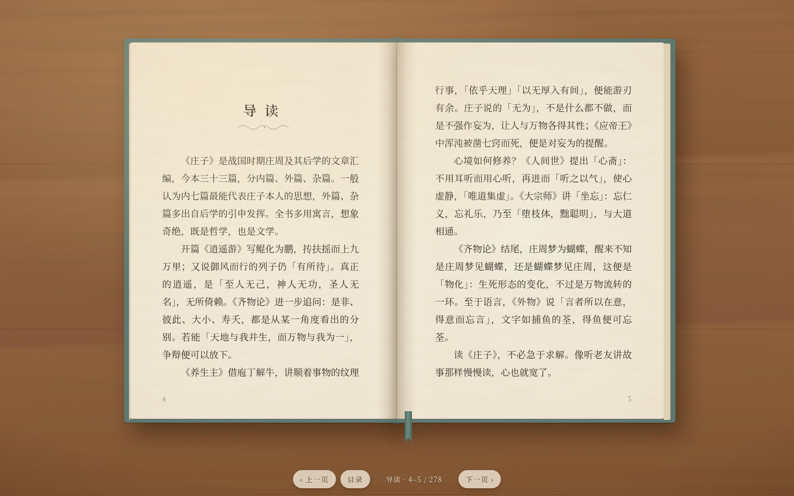

# 庄子 · 互动书

一本放在橡木书桌上的《庄子》立体书：用 Three.js 建模，翻开封面，三十三篇用大白话重新讲了一遍，逐页可读，没有文言。每一篇开头有一页导读，对页是一幅墨线插图——翻到那里，纸片会先像印刷一样浮现在纸面，再一张张立起来动起来。

在线阅读：<https://cocohahaha.github.io/zhuangzi-book/>



## 怎么读

- **翻页**：滚动鼠标滚轮或触控板（一次滑动只翻一页）、按 ← → ↑ ↓ / 空格 / PageUp PageDown，或点书的左右两半；也可以拖动书页，页角会跟着手卷起来。
- **手机**：竖屏时一次看一页，左右或上下滑动、轻点屏幕左右两侧，就在左右页之间移动、翻页。
- **插图**：翻到插图页，纸片自己立起来、故事自己演，不用点。图里的人和物会依次亮起、做个小动作，图下用手写体写出一两句白话说明，「图中」里的小圆圈依次被朱笔点上。用鼠标时也可以点图里的东西，提前看到那一条。
- **页边旁批**：正文里有名的故事（庖丁解牛、濠梁之辩、白驹过隙……），翻到时页边会用朱笔写出名目，正文下划一道。
- **导读页的「本篇故事」**：点标签直接翻到那一页。
- **目录**：底栏左侧按钮，或在目录页点篇名。
- 会记住读到哪里，下次打开接着读；也可以用 `#p=页码` 直接打开某一页（就是书页上印的页码），例如 `#p=34`（养生主）。
- 右下角可以关掉翻页声（声音由 WebAudio 现场合成）。

## 每篇的插图

| 篇 | 插图 |
|---|---|
| 扉页 | 远山、祥云、行人、飞鸟，纸片层层立起 |
| 导读 | 三束竹简：内篇七、外篇十五、杂篇十一，点哪束哪束跳起来 |
| 逍遥游 | 北冥海浪里鲲在游，跃出水面化为鹏，沿着「扶摇」盘旋而上，在书页上空投下影子；榆枝上的鸴鸠跳一跳 |
| 齐物论 | 庄周在榻上睡着，一条墨线在人形与蝶形之间来回变化（物化），蝴蝶绕着梦飞 |
| 养生主 | 一头标出骨节的牛，朱红的刀路顺着「间」流动，刀沿刀路游走；点骨节牛体分解再合拢 |
| 人间世 | 巨大的栎社树荫下卧着牛，匠石走过看都不看；颜回心斋，一圈圈空出去的气 |
| 德充符 | 王骀立在止水边，众人围拢；点水面起涟漪，倒影散乱，静下来才映得清楚 |
| 大宗师 | 涸泉底两条鱼相呴以湿，点江湖，水来了，鱼游回江湖相忘 |
| 应帝王 | 日升月落，儵与忽一天为浑沌凿一窍，第七天浑沌倒下 |

外篇、杂篇各篇的插图见下文「各篇动效」。

## 内容

- 正文：《庄子》三十三篇逐篇改写成的现代白话，故事、论点和顺序都照原书走，约十三万字，每篇有一行白话小标题。内篇七、外篇十五、杂篇十一。底本是维基文库《莊子》（公有领域）。
- 数据在 `content/zhuangzi.json`，`scripts/fetch.py` 抓取的是底本原文（现已不在书中显示），来源说明见 `content/SOURCE.md`。
- 白话导读、插图批注、页边旁批写在 `js/copy.js`；`node scripts/check-copy.mjs` 核对旁批关键词都在正文里，并检查有没有文言残留和生僻字。

## 技术

纯静态页面，不需要构建；Three.js（r170）放在 `vendor/` 里，不依赖 CDN。

```
index.html          页面与底栏
css/app.css         界面样式
js/app.js           主程序：状态、翻页、拖拽、镜头、阅读位置
js/book.js          书的模型：精装封面、书脊、书块、会卷曲的书页（curl / bulge / droop）
js/stage.js         橡木桌、皮革书写垫、灯光（天光 / 主光投影 / 侧补光）、竹影
js/pages.js         方格排版（避头尾、句末标点悬挂）与每页的 canvas 绘制
js/popup.js         立体插图框架：纸片折起、翅膀、墨线、可点的热区
js/ink.js, art.js   毛笔线、淡彩、人物、树、山、水、云等墨线造型
js/scenes/          各篇插图
js/audio.js         翻页、纸片、落笔的合成音效
vendor/three/       three.module.min.js 与 Line2 线条扩展
```

本地预览需要通过 HTTP 打开（直接双击 `index.html` 读不到 JSON 和模块）：

```sh
python3 -m http.server 8000
# 打开 http://localhost:8000/
```

字体用 Google Fonts 的 Noto Serif SC（正文）与 Ma Shan Zheng（批注手写体），加载不到时自动退回系统宋体、楷体。
